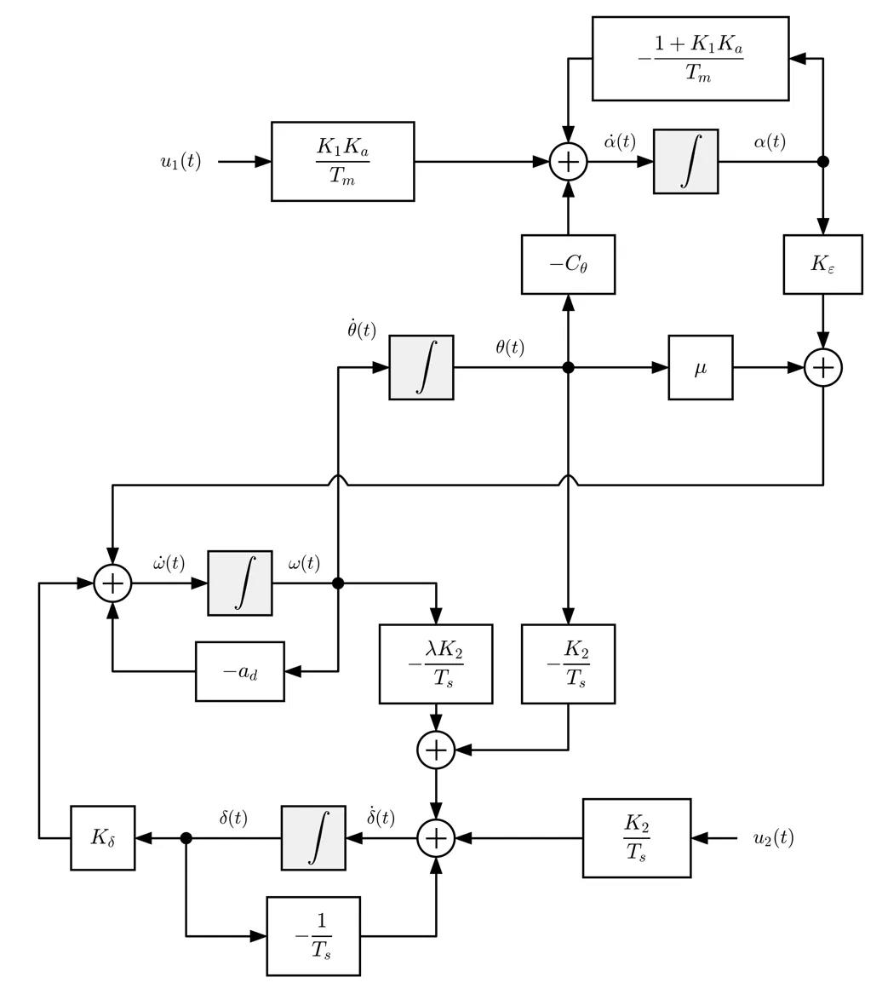

# Modelo MIMO de un Cohete en el Plano de Cabeceo — Análisis de Control

Repositorio de código y análisis del proyecto final **«Modelación y Simulación de Sistemas: Cohete en el Plano de Cabeceo»** (Teoría de Sistemas II, Universidad Galileo, Guatemala).

**Autores:** Rodrigo Ponce Paz · Leones Morales De Paz · Juan Carlos Gordillo Alarcon · Javier Antonio Rodas Rojas

**Repositorio:** <https://github.com/Cheps01/rocket-model>

El cohete se modela como un sistema **MIMO** lineal e invariante en el tiempo de **4 estados, 2 entradas y 2 salidas**. Todo el análisis (modelado, estabilidad, respuesta temporal y en frecuencia, acoplamiento, observabilidad y controlabilidad, selección de ganancias) vive en un único cuaderno, [`analysis.ipynb`](analysis.ipynb), apoyado por dos módulos pequeños en [`src/`](src/). Este README sirve de guía para ubicar cada resultado del reporte dentro del repositorio.

---

## Índice

1. [Resumen](#1-resumen)
2. [Guía rápida: qué ver y dónde](#2-guía-rápida-qué-ver-y-dónde)
3. [Estructura del repositorio](#3-estructura-del-repositorio)
4. [Modelo matemático](#4-modelo-matemático)
   - 4.1 [Variables](#41-variables)
   - 4.2 [Ecuaciones de estado](#42-ecuaciones-de-estado)
   - 4.3 [Parámetros nominales](#43-parámetros-nominales)
   - 4.4 [Diagrama de simulación](#44-diagrama-de-simulación)
5. [Mapa del cuaderno `analysis.ipynb`](#5-mapa-del-cuaderno-analysisipynb)
6. [Resultados principales y dónde se obtienen](#6-resultados-principales-y-dónde-se-obtienen)
7. [Correspondencia con el reporte LaTeX](#7-correspondencia-con-el-reporte-latex)
8. [Código fuente (`src/`)](#8-código-fuente-src)
9. [Requisitos e instalación](#9-requisitos-e-instalación)
10. [Cómo ejecutar](#10-cómo-ejecutar)
    - 10.1 [Localmente con Jupyter](#101-localmente-con-jupyter)
    - 10.2 [En Google Colab](#102-en-google-colab)
11. [Notas de reproducibilidad y limitaciones conocidas](#11-notas-de-reproducibilidad-y-limitaciones-conocidas)
12. [Cómo citar](#12-cómo-citar)

---

## 1. Resumen

Se estudia el control de actitud de un cohete en el plano de cabeceo durante la fase atmosférica del ascenso. El modelo incluye la dinámica del motor y del servo de la tobera, el efecto gravitatorio, el momento aerodinámico desestabilizante, el amortiguamiento aerodinámico y la desalineación del empuje.

Hallazgos centrales (detalle y ubicación en la [sección 6](#6-resultados-principales-y-dónde-se-obtienen)):

- El vehículo es **inestable en lazo abierto**; sin el canal de dirección ($K_2 = 0$) aparece un polo en el semiplano derecho.
- Existe una **ganancia mínima de dirección** $K_{2,\min} \approx 0{,}081$ (para $K_1 = 1$) por debajo de la cual el sistema es inestable. La frontera es casi independiente de $K_1$.
- El **acoplamiento entre canales es asimétrico**: la deflexión de la tobera ($u_2$) afecta fuertemente la aceleración axial, mientras que el empuje ($u_1$) casi no perturba la actitud. Por eso el cohete debe analizarse como **un único sistema multivariable**.
- El sistema es observable y controlable con cada sensor y cada actuador por separado; con $K_2 = 0$ **pierde controlabilidad**.
- Rango de ganancias propuesto: $K_2 \in [0{,}40;\ 0{,}68]$ (nominal $0{,}50$), acotado por la deflexión máxima de la tobera.

## 2. Guía rápida: qué ver y dónde

| Si quieres… | Ve a… |
|---|---|
| Entender el modelo y sus ecuaciones | [Sección 4](#4-modelo-matemático) de este README y la sección *(A)* del cuaderno |
| Ver el diagrama de bloques/simulación | [`simulation-diagram.jpeg`](simulation-diagram.jpeg) ([§4.4](#44-diagrama-de-simulación)) |
| Ver el valor numérico de cada parámetro | [§4.3](#43-parámetros-nominales) y la primera celda de código del cuaderno |
| Ver cómo se obtienen $A$, $B$, $C$, $D$ | [`src/system_rep.py`](src/system_rep.py) → `get_all_matrixes` y cuaderno *(A) §3* |
| Ver la matriz de transferencia $G(p)$ | Cuaderno *(A) §4* |
| Ver el umbral de estabilidad $K_{2,\min}$ y el mapa $(K_1,K_2)$ | Cuaderno *(B) §6* (Routh–Hurwitz + mapa) |
| Ver respuestas a pulso / senoide / impulso | Cuaderno *(B) §7* |
| Ver el acoplamiento cruzado cuantificado | Cuaderno *(B) §8* |
| Ver diagramas de Bode, ancho de banda y resonancia | Cuaderno *(C) §9 y §10* |
| Ver observabilidad y controlabilidad | Cuaderno *(D) §11 y §12*, función en [`src/properties.py`](src/properties.py) |
| Ver el rango de ganancias recomendado y las conclusiones | Cuaderno *(E)* y *(F)* |
| Saber qué figura/tabla del reporte sale de qué celda | [Sección 7](#7-correspondencia-con-el-reporte-latex) |
| Reproducir todo | [Secciones 9 y 10](#9-requisitos-e-instalación) |
| Saber qué tener en cuenta antes de citar un resultado | [Sección 11](#11-notas-de-reproducibilidad-y-limitaciones-conocidas) |

## 3. Estructura del repositorio

```
rocket-model/
├── README.md                # Esta guía
├── analysis.ipynb           # Cuaderno con todo el análisis (secciones A–F), con salidas ya guardadas
├── simulation-diagram.jpeg  # Diagrama de simulación del modelo (4 integradores)
├── .gitignore               # Ignora __pycache__/
└── src/
    ├── __init__.py          # Marca src/ como paquete (el cuaderno lo usa para ubicar la raíz)
    ├── system_rep.py        # Extracción de matrices A,B,C,D, evaluación numérica y despliegue de ecuaciones
    └── properties.py        # Clase SystemProps: is_stable, is_controlable, is_observable
```

El reporte técnico (LaTeX, `Reporte.pdf`) **no forma parte de este repositorio**; se entrega por separado. La [sección 7](#7-correspondencia-con-el-reporte-latex) indica qué parte del repositorio respalda cada parte del reporte.

## 4. Modelo matemático

### 4.1 Variables

| Tipo | Símbolo | Descripción | Unidades |
|---|---|---|---|
| Entrada | $u_1(t)$ | Comando de aceleración axial (canal de **empuje**) | % |
| Entrada | $u_2(t)$ | Comando de ángulo de cabeceo (canal de **dirección**, tobera) | rad |
| Estado | $a(t)$ | Aceleración axial | m/s² |
| Estado | $\theta(t)$ | Ángulo de cabeceo | rad |
| Estado | $\omega(t)$ | Velocidad angular de cabeceo | rad/s |
| Estado | $\delta(t)$ | Deflexión de la tobera | rad |
| Salida | $y_1(t)$ | Aceleración axial medida (acelerómetro) | m/s² |
| Salida | $y_2(t)$ | Ángulo de cabeceo medido (unidad inercial, IMU) | rad |

Ganancias ajustables: $K_1$ (canal de empuje), $K_2$ (canal de dirección) y $T$ (período de muestreo del controlador digital; ver [§11](#11-notas-de-reproducibilidad-y-limitaciones-conocidas)).

### 4.2 Ecuaciones de estado

Con $x = [a,\ \theta,\ \omega,\ \delta]^\top$ y $u = [u_1,\ u_2]^\top$:

$$
\begin{aligned}
\dot a      &= -\frac{1 + K_1 k_a}{T_m}\,a \;-\; c_\theta\,\theta \;+\; \frac{K_1 k_a}{T_m}\,u_1\\
\dot\theta  &= \omega\\
\dot\omega  &= k_\varepsilon\,a \;+\; \mu\,\theta \;-\; a_d\,\omega \;+\; k_\delta\,\delta\\
\dot\delta  &= -\frac{K_2}{T_s}\,\theta \;-\; \frac{\lambda K_2}{T_s}\,\omega \;-\; \frac{1}{T_s}\,\delta \;+\; \frac{K_2}{T_s}\,u_2
\end{aligned}
\qquad
y = \begin{bmatrix}1&0&0&0\\0&1&0&0\end{bmatrix}x
$$

$$
\dot x = Ax + Bu,\qquad y = Cx + Du,\qquad D = 0,\qquad G(p) = C\,(pI - A)^{-1}B
$$

Los términos que **acoplan** los dos canales son $-c_\theta\,\theta$ (la inclinación quita aceleración axial) y $k_\varepsilon\,a$ (la aceleración, con el empuje desalineado, genera un torque parásito).

### 4.3 Parámetros nominales

Idénticos al Cuadro I del reporte y a la primera celda de código del cuaderno:

| Símbolo | Variable en el código | Descripción | Valor | Unidades |
|---|---|---|---|---|
| $k_a$ | `ka` | Ganancia del actuador de empuje | 0,0655 | (m/s²)/% |
| $1/T_m$ | `inv_tm` | Ancho de banda del motor | 1,0672 | s⁻¹ |
| $c_\theta$ | `c0` | Acoplamiento gravitatorio | 9,81 | (m/s²)/rad |
| $\mu$ | `mu` | Rigidez aerodinámica (desestabilizante) | 1,20 | s⁻² |
| $a_d$ | `ad` | Amortiguamiento aerodinámico | 0,35 | s⁻¹ |
| $k_\delta$ | `kd` | Efectividad de la tobera | 8,50 | s⁻²/rad |
| $k_\varepsilon$ | `ke` | Acoplamiento por desalineación del empuje | 0,12 | rad/m |
| $T_s$ ($1/T_s = 20$ s⁻¹) | `ts` = 0,05 | Constante de tiempo del servo | 0,05 | s |
| $\lambda$ | `lmd` | Proporción velocidad/posición de la IMU | 0,60 | s |
| $K_1,\ K_2$ | `k1`, `k2` | Ganancias de empuje y dirección | variables (nominal 1,0 y 0,5) | – |
| $T$ | `T` | Período de muestreo | variable (no evaluado) | s |

### 4.4 Diagrama de simulación



Cuatro integradores (uno por estado). Cada término de las ecuaciones de la [§4.2](#42-ecuaciones-de-estado) corresponde a un bloque del diagrama. Si $K_2 = 0$ desaparecen todas las trayectorias que alimentan $\dot\delta$ desde $\theta$, $\omega$ y $u_2$: la tobera solo decae hacia $\delta = 0$ y ya no se puede controlar. Nota: el diagrama nombra la aceleración axial $\alpha(t)$ y el cuaderno la llama `a(t)`; es la misma variable.

## 5. Mapa del cuaderno `analysis.ipynb`

El cuaderno está dividido en seis partes, cada una con sus subsecciones numeradas (los encabezados del cuaderno usan exactamente esta numeración). Las salidas (gráficas y tablas) ya vienen guardadas en el archivo, por lo que se pueden consultar sin ejecutar nada.

| Parte | § | Contenido | Herramientas principales |
|---|---|---|---|
| *(inicio)* | – | Imports, localización de la raíz del proyecto, definición de símbolos, constantes y de las 4 ecuaciones de estado y 2 de salida | `sympy` |
| **(A) Modelado** | 1 | Análisis del sistema: función de cada bloque y de cada parámetro | texto |
| | 2 | Diagrama de simulación y trayectorias que desaparecen con $K_2 = 0$ o sin acoplamiento | texto + [`simulation-diagram.jpeg`](simulation-diagram.jpeg) |
| | 3 | Ecuación de estados: extracción simbólica de $A,B,C,D$ | `get_all_matrixes` |
| | 4 | Matriz de transferencia simbólica $G(p)$ (4 elementos, mismo denominador) | `sympy` |
| | 5 | Ecuación de salida y tres configuraciones de sensores | texto |
| **(B) Estabilidad y respuesta temporal** | 6 | Polinomio característico, tabla de Routh–Hurwitz ($K_{2,\min}$) y mapa de estabilidad en $(K_1,K_2)$ | `numpy`, `matplotlib` |
| | 7 | Respuesta a pulso de 5 s, senoide e impulso (aprox. con $K=100$) en $u_1$, $u_2$ y ambas; cinco pares $(K_1,K_2)$ | `scipy.signal.lsim` |
| | 8 | Cuantificación del acoplamiento con escalón en una entrada y teorema del valor final | `scipy.signal.lsim` |
| **(C) Frecuencia** | 9 | Función de transferencia numérica ($K_1=1,\ K_2=0{,}5$), polos/ceros y Bode 2×2 | `scipy.signal.bode` |
| | 10 | Ancho de banda a −3 dB, ganancia DC y pico de resonancia por canal; efecto de variar $K_2$ de 0,10 a 1,00 | `numpy`, `matplotlib` |
| **(D) Observabilidad y controlabilidad** | 11 | Observabilidad con tres configuraciones de sensores | `SystemProps.is_observable` |
| | 12 | Controlabilidad con tres configuraciones de entradas, y caso $K_2 = 0$ | `SystemProps.is_controlable` |
| **(E) Selección de ganancias** | – | Criterios y rangos recomendados de $K_1$ y $K_2$ | texto |
| **(F) Conclusiones** | – | Efecto de $K_1$ y $K_2$, acoplamiento, MIMO vs. sistemas independientes, muestreo | texto |

## 6. Resultados principales y dónde se obtienen

Valores tal como aparecen en el cuaderno, con $K_1 = 1$ y $K_2 = 0{,}5$ salvo que se indique otra cosa.

| Resultado | Valor | Ubicación |
|---|---|---|
| Polinomio característico | $p^4 + a_3p^3 + a_2p^2 + a_1p + a_0$, con $a_3 = 0{,}0699K_1 + 21{,}42$; $a_2 = 1{,}423K_1 + 102{,}0K_2 + 27{,}52$; $a_1 = 7{,}13K_1K_2 + 0{,}4054K_1 + 278{,}9K_2 - 16{,}63$; $a_0 = 11{,}88K_1K_2 - 1{,}678K_1 + 181{,}4K_2 - 2{,}069$ | (B) §6 |
| Ganancia mínima de dirección (Routh–Hurwitz) | $K_{2,\min} \approx 0{,}0809$ para $K_1 = 1$ (≈ 0,0811 con coeficientes exactos) | (B) §6 |
| Sin canal de dirección ($K_2 = 0$) | Polo en el semiplano derecho → inestable | (B) §6, mapa de estabilidad |
| Acoplamiento $u_1 \to y$ (escalón) | $a = 0{,}0459$ m/s²; $\theta = 0{,}001806$ rad (0,1035°) | (B) §8 |
| Acoplamiento $u_2 \to y$ (escalón) | $a = -8{,}9751$ m/s²; $\theta = 1{,}0403$ rad (59,6°) | (B) §8 |
| Ancho de banda −3 dB | $G_{11}$: 1,986 · $G_{12}$: 1,364 · $G_{21}$: 1,367 · $G_{22}$: 2,292 rad/s | (C) §10 |
| Ganancia DC | $G_{11}$: −26,91 dB · $G_{12}$: 19,48 dB · $G_{21}$: −55,01 dB · $G_{22}$: 0,20 dB | (C) §10 |
| Observabilidad | Rango completo con ambos sensores, solo acelerómetro y solo cabeceo | (D) §11 |
| Controlabilidad ($K_2 = 0{,}5$) | Rango completo con ambas entradas, solo $u_1$ y solo $u_2$ | (D) §12 |
| Controlabilidad ($K_2 = 0$) | No controlable en los tres casos (el estado $\delta$ queda fuera de alcance) | (D) §12 |
| Rangos recomendados | $K_2 \in [0{,}40;\ 0{,}68]$ (nominal 0,50). Para $K_1$ el cuaderno indica $[1{,}00;\ 1{,}50]$ (ver [§11](#11-notas-de-reproducibilidad-y-limitaciones-conocidas)) | (E) |

## 7. Correspondencia con el reporte LaTeX

Reporte: *Proyecto Final — Modelación y Simulación de Sistemas: Cohete en el Plano de Cabeceo* (secciones I–V y Anexo).

### 7.1 Por sección del reporte

| Sección del reporte | Respaldo en el repositorio |
|---|---|
| I. Introducción | – (contexto y bibliografía; no depende del código) |
| II. Metodología — hipótesis y diagrama | Cuaderno (A) §1–2 y [`simulation-diagram.jpeg`](simulation-diagram.jpeg) |
| II. Metodología — estado, salida, $G(p)$ | Cuaderno (A) §3–5; [`src/system_rep.py`](src/system_rep.py) |
| II. Metodología — estabilidad, Routh–Hurwitz, mapa | Cuaderno (B) §6 |
| II. Metodología — respuesta temporal y acoplamiento | Cuaderno (B) §7–8 |
| II. Metodología — frecuencia, ancho de banda, resonancia | Cuaderno (C) §9–10 |
| II. Metodología — observabilidad y controlabilidad | Cuaderno (D) §11–12; [`src/properties.py`](src/properties.py) |
| II. Metodología — selección de ganancias | Cuaderno (E) |
| III. Resultados | Ver tabla 7.2 |
| IV. Discusión | Cuaderno (E) y (F) (versión extendida de las mismas ideas) |
| V. Conclusión | Cuaderno (F) |
| Anexo — Cuadro I (parámetros) | [§4.3](#43-parámetros-nominales) y primera celda de código |
| Anexo — Cuadro II (variables) | [§4.1](#41-variables) |

### 7.2 Por figura del reporte

| Figura del reporte | Contenido | Dónde se genera |
|---|---|---|
| Fig. 1 | Mapa de estabilidad en el plano $(K_1, K_2)$ | Cuaderno (B) §6 — celda de la malla de ganancias |
| Fig. 2 | Respuesta del ángulo de cabeceo a un escalón en $u_2$ para varios $K_2$ ($K_1 = 1$) | **No tiene una celda dedicada en el cuaderno** (ver [§11](#11-notas-de-reproducibilidad-y-limitaciones-conocidas)); las respuestas más cercanas están en (B) §7–8 |
| Fig. 3 | Respuesta de $y_1$ y $y_2$ a un pulso de 5 s en ambas entradas ($K_1 = 1,\ K_2 = 0{,}5$) | Cuaderno (B) §7 — caso «Pulso Cuadrado en Ambas» |
| Fig. 4 | Magnitud de los cuatro elementos de $G(j\omega)$ ($K_1 = 1,\ K_2 = 0{,}5$) | Cuaderno (C) §9–10 — diagramas de Bode y de magnitud por canal |
| Cuadros I y II | Parámetros y variables | [§4.3](#43-parámetros-nominales) y [§4.1](#41-variables) |

## 8. Código fuente (`src/`)

El cuaderno localiza la raíz del proyecto buscando un directorio que contenga `src/__init__.py` y lo agrega a `sys.path`, por lo que basta ejecutar con el directorio de trabajo dentro del repositorio.

### [`src/system_rep.py`](src/system_rep.py)

| Función | Qué hace |
|---|---|
| `zeros(height, width)` | Crea una matriz (lista de listas) de ceros. |
| `get_all_matrixes(state_system, output_system, states, inputs, outputs)` | Recibe las ecuaciones `sympy.Eq` de estado y de salida y devuelve $A,B,C,D$ simbólicas, tomando el coeficiente de cada estado/entrada en el lado derecho de cada ecuación. |
| `display_state_equations(A, B, C, D, states, inputs)` | Imprime las ecuaciones de estado y de salida a partir de las matrices. |
| `numeric_matrixes(A, B, C, D, sym)` | Sustituye valores numéricos (p. ej. `{k1: 1, k2: 0.5}`) y devuelve las matrices como listas de `float`. |

### [`src/properties.py`](src/properties.py)

| Método (estático) de `SystemProps` | Qué hace |
|---|---|
| `is_stable(A)` | `True` si todos los autovalores de $A$ tienen parte real negativa. |
| `is_controlable(A, B)` | Construye $[B,\ AB,\ \dots,\ A^{n-1}B]$ y verifica rango $= n$. |
| `is_observable(A, C)` | Construye $[C;\ CA;\ \dots;\ CA^{n-1}]$ y verifica rango $= n$. |

## 9. Requisitos e instalación

- Python 3.10 o superior
- `sympy`, `numpy`, `scipy`, `matplotlib`, y `jupyter` para abrir el cuaderno

```bash
pip install sympy numpy scipy matplotlib jupyter
```

## 10. Cómo ejecutar

### 10.1 Localmente con Jupyter

```bash
git clone https://github.com/Cheps01/rocket-model.git
cd rocket-model
jupyter notebook analysis.ipynb
```

Una vez abierto, usar **Cell → Run All**. El cuaderno tarda unos minutos por los bucles sobre mallas de ganancias y las gráficas de respuesta temporal.

### 10.2 En Google Colab

**Opción 1: clonar desde GitHub (recomendada).**

1. Abrir un notebook en [Google Colab](https://colab.research.google.com/) y, en una celda, clonar el repositorio:

```python
!git clone https://github.com/Cheps01/rocket-model.git
%cd rocket-model
```

2. Instalar dependencias:

```python
!pip install -q sympy numpy scipy matplotlib
```

3. Subir `analysis.ipynb` (panel izquierdo → **Archivos** → subir), o usar:

```python
from google.colab import files
files.upload()  # seleccionar analysis.ipynb
```

4. Verificar que el directorio de trabajo sea la raíz del proyecto:

```python
import os
os.chdir('/content/rocket-model')
print(os.getcwd())  # debe imprimir .../rocket-model
```

5. Ejecutar todo: **Runtime → Run all** (o `Ctrl+F9`).

**Opción 2: subir el proyecto como ZIP.**

```python
from google.colab import files
import zipfile, os

uploaded = files.upload()  # subir rocket-model.zip

with zipfile.ZipFile('rocket-model.zip', 'r') as z:
    z.extractall('/content')

os.chdir('/content/rocket-model')  # ajustar si el ZIP tiene otra estructura
!pip install -q sympy numpy scipy matplotlib
```

Luego abrir `analysis.ipynb` y usar **Runtime → Run all**.

**Notas para Colab:** la segunda celda del cuaderno inserta la raíz del proyecto en `sys.path` buscando `src/__init__.py`, por eso el directorio de trabajo debe estar dentro del repositorio. Los gráficos se muestran en línea automáticamente.

## 11. Notas de reproducibilidad y limitaciones conocidas

Para que quien cite este repositorio sepa exactamente qué respalda el código y qué no:

1. **Período de muestreo $T$.** Se declara como símbolo, pero el modelo es continuo y $T$ **no se evalúa** en ninguna simulación; el efecto del muestreo se trata solo de forma cualitativa (cuaderno (F) y trabajo futuro del reporte).
2. **Resultados del reporte sin celda dedicada.** La Fig. 2 (barrido de $K_2$ = 0,25; 0,5; 0,68; 1,2), las cifras de sobreimpulso y tiempo de asentamiento, la comparación de polo dominante/amortiguamiento de las cinco combinaciones de ganancias y la excursión máxima de la tobera (≈ 30° para $K_2 = 0{,}68$) **no se calculan en el cuaderno entregado**: allí aparecen como texto en la sección (E), y las cinco combinaciones solo se grafican en (B) §7. Si se citan, conviene indicar que provienen de simulaciones del reporte.
3. **Rango recomendado de $K_1$.** El reporte propone $1 \le K_1 \le 2$; el cuaderno (E) indica $1{,}00 \le K_1 \le 1{,}50$. Ambos coinciden en $0{,}40 \le K_2 \le 0{,}68$.
4. **Valor de $K_{2,\min}$.** El cuaderno da $\approx 0{,}0809$ (resolviendo la cuadrática con coeficientes redondeados) y $\approx 0{,}0811$ con coeficientes exactos; en (E) se usa $0{,}0810$. El reporte lo redondea a $\approx 0{,}08$.
5. **Verificación de observabilidad.** En la celda de §11 la condición está escrita como `if ({SystemProps.is_observable(...)})`; las llaves crean un conjunto no vacío, que siempre es verdadero, así que esa celda imprime «Observable» para cualquier configuración. La conclusión de observabilidad se apoya en el rango completo de la matriz de observabilidad (que sí implementa `is_observable`), pero la salida impresa de esa celda por sí sola no lo demuestra.
6. **Controlabilidad con dos entradas.** `is_controlable` arma la matriz usando solo la **primera columna** de $B$ (`[:, 0]`), por lo que la configuración «ambos comandos» se evalúa en realidad con $u_1$ únicamente. Los rangos que menciona el reporte (3 con ambas entradas y con solo $u_1$, y 0 con solo $u_2$ para $K_2 = 0$) son consistentes con ese cálculo, pero el cuaderno solo imprime *controlable / no controlable*, no el valor del rango.
7. **Salida $y_3 = \omega$.** El caso con velocidad angular como tercera salida está descrito en el texto de §5, pero no se simula ni se usa en el análisis de observabilidad.
8. **Nombres en el código.** En la definición de estados, la función de `theta` se crea con el nombre `'0'` y los comentarios de `theta`/`omega` no describen bien a la variable (p. ej. `theta` dice «angular velocity»); es solo de etiquetado y no afecta a las matrices. Tampoco se usa `SystemProps.is_stable` en el cuaderno (la estabilidad se evalúa con autovalores directamente).
9. **Coeficientes fijos en §10.** Las funciones de magnitud usadas para el ancho de banda tienen los coeficientes numéricos escritos a mano para $K_1 = 1$, $K_2 = 0{,}5$; si se cambian las ganancias nominales o las constantes, esa celda debe actualizarse.
10. **Alcance del modelo.** Lineal, plano de cabeceo, ángulos pequeños, masa/inercia/presión dinámica constantes, motor y servo de primer orden, cuerpo rígido; sin saturación de la tobera ni movimiento lateral.

## 12. Cómo citar

Si se hace referencia a este repositorio en un trabajo, se sugiere citar el reporte y el repositorio:

> Ponce Paz, R., Morales De Paz, L., Gordillo Alarcon, J. C. y Rodas Rojas, J. A. *Proyecto Final — Modelación y Simulación de Sistemas: Cohete en el Plano de Cabeceo.* Universidad Galileo, Teoría de Sistemas II, Guatemala. Código: <https://github.com/Cheps01/rocket-model>

Al citar un resultado numérico, se recomienda indicar la parte y subsección del cuaderno de donde proviene (por ejemplo, «`analysis.ipynb`, parte (B) §8») según la [sección 6](#6-resultados-principales-y-dónde-se-obtienen).
